# SocBridge

An [MCP](https://modelcontextprotocol.io) server that puts a security tooling
stack behind **one authenticated HTTPS endpoint**, so an MCP client such as
Claude Code can query it with a single per-user token.

| Backend | Read | Write (off by default) |
|---|---|---|
| Wazuh | Agents, groups, inventory, SCA, FIM, rules (manager API); alerts, vulnerabilities and attack trend (indexer) | Agent group membership; active-response commands from an admin-defined list |
| Trivy | Container and filesystem scan results from JSON reports | – |
| DefectDojo | Findings, engagements, products, tests, endpoints, imports, SLA (open-source edition) | Close, risk-accept or mark one finding as false positive |
| Graylog | Log search, streams, events and alert definitions, dashboards, saved searches, system health, firewall trend; optional passthrough to Graylog's own MCP server | – |
| Threat intel | CISA KEV and FIRST EPSS, joined with the CVEs from Wazuh, Trivy and DefectDojo to rank what to fix first | – |

Everything is **read-only until you switch writing on**, per backend, user and
token; see [Read and write access](#read-and-write-access). Every tool call is
in the audit log, and the built-in assistant never gets write tools.

## Screenshots

The screenshots come from a demo installation with mock Wazuh, DefectDojo and
Graylog servers and sample Trivy reports; host names, addresses and findings
are sample data.

**Findings.** Vulnerability state from Wazuh, Trivy, DefectDojo and Graylog,
one tab each. The Wazuh tab shows the trend per agent, new against resolved
findings, and the open findings per severity. Administrators get a status bar
at the top: a dot for health and a padlock for encryption per service, with
the details on mouseover.

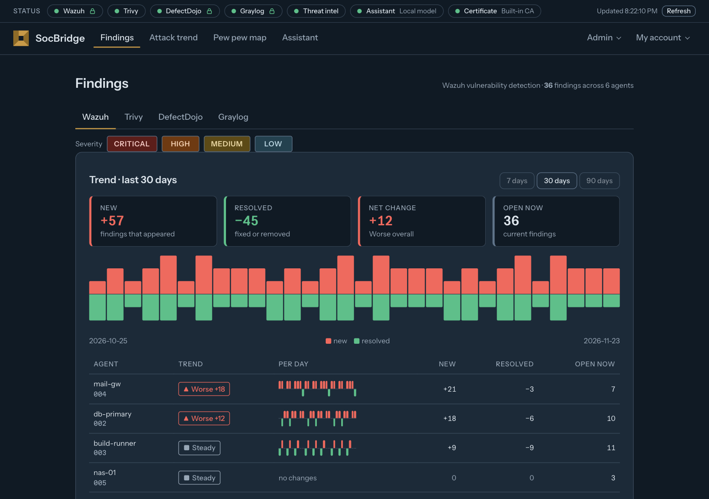

<details>
<summary>Most affected agents and one agent's findings</summary>

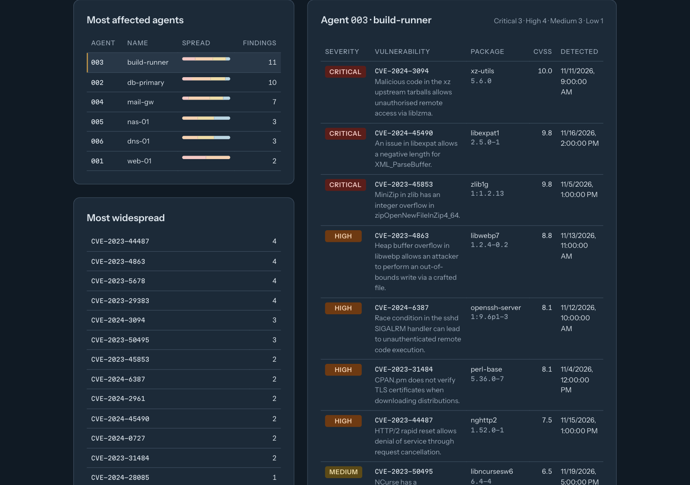

</details>

**Read and write.** Each token has its own access per backend, and the
write tools are opted into one by one on the Backends page.

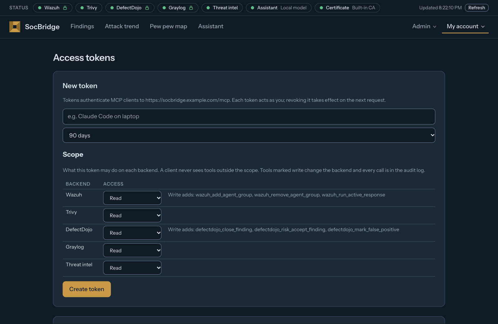

<details>
<summary>Allowing write tools, granting them to users, and approving an app</summary>

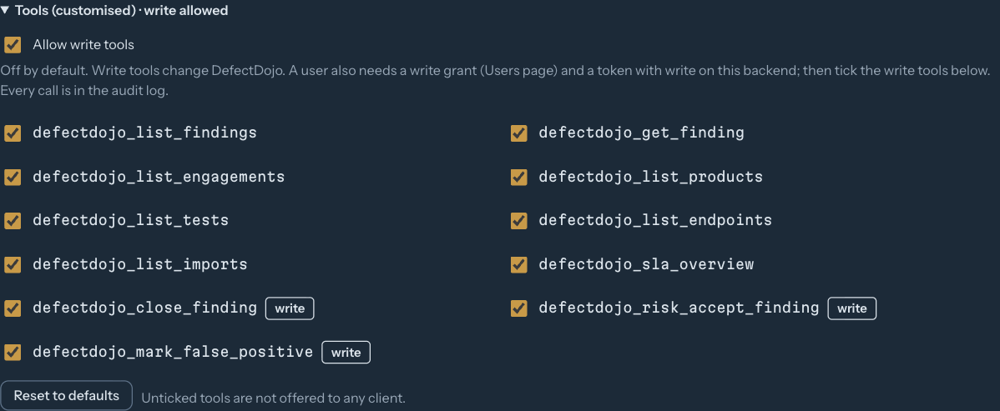

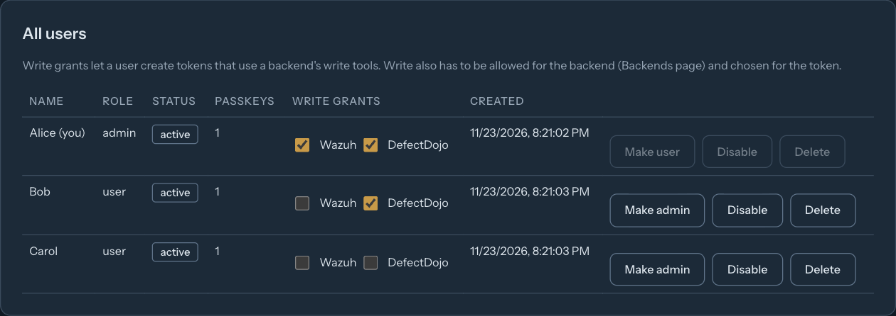

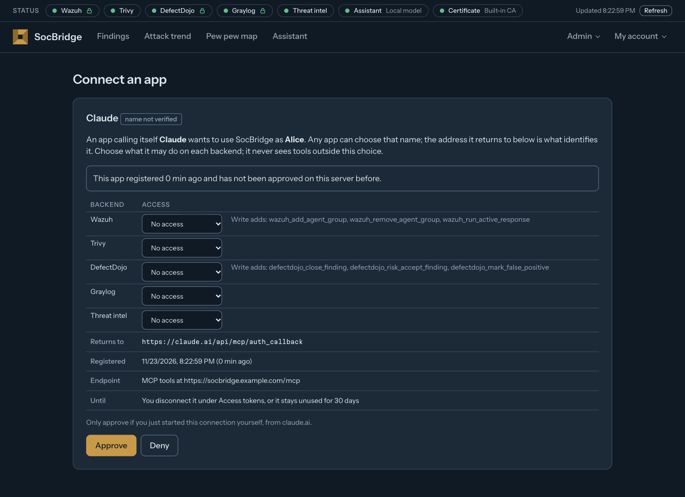

</details>

**Audit and usage.** Every call with its user, credential, arguments and
outcome. Here one token closes a finding, changes an agent group and blocks an
address; the denied row is the same write attempted with a read-only token.

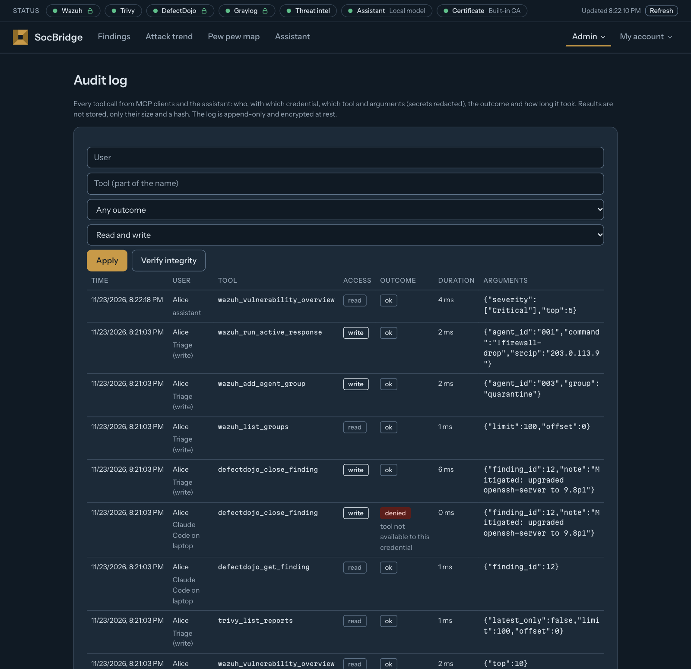

<details>
<summary>Usage per service, tool, user and day</summary>

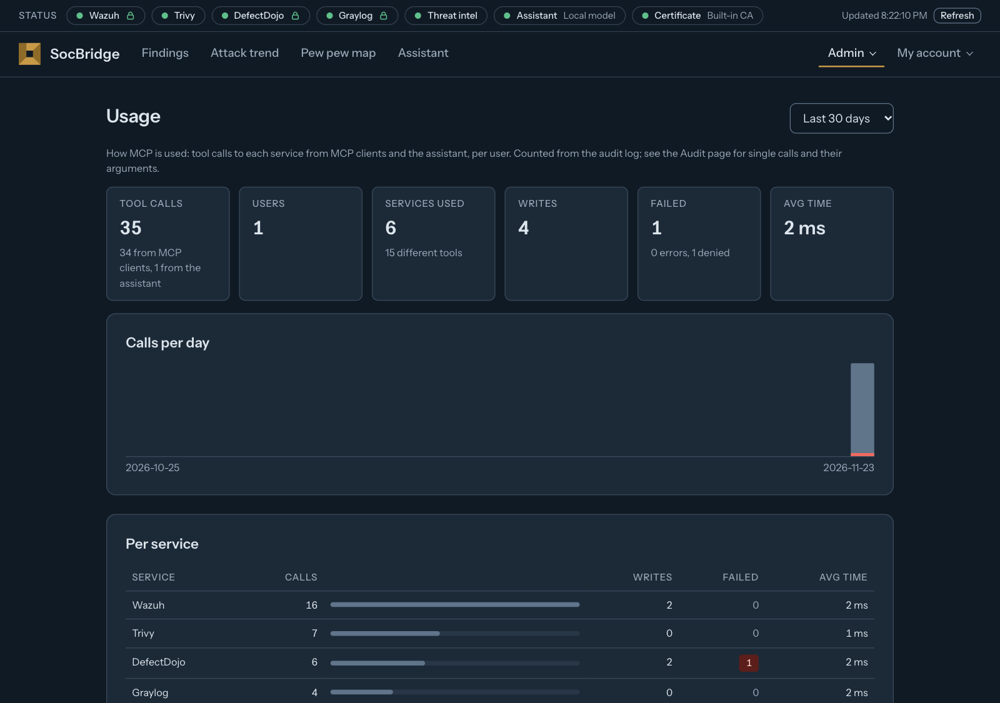

</details>

**Assistant.** Questions in plain language, answered with the read-only tools.
Each tool call and its arguments are shown as it runs.

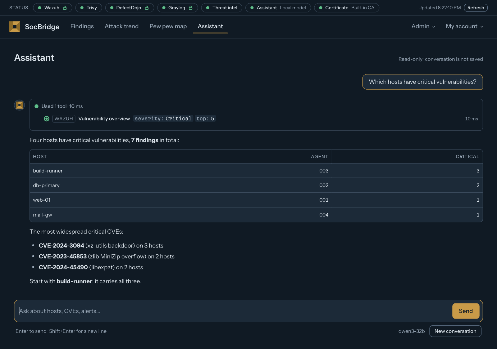

**Attack trend.** Attacks over time, one chart per type: failed logins per
service from Wazuh (bars with brute-force alerts in red), and port scans,
firewall blocks and IPS blocks from Graylog. From 24 hours to 3 years or any
dates, by attempts or unique IP addresses, compared with the period before.

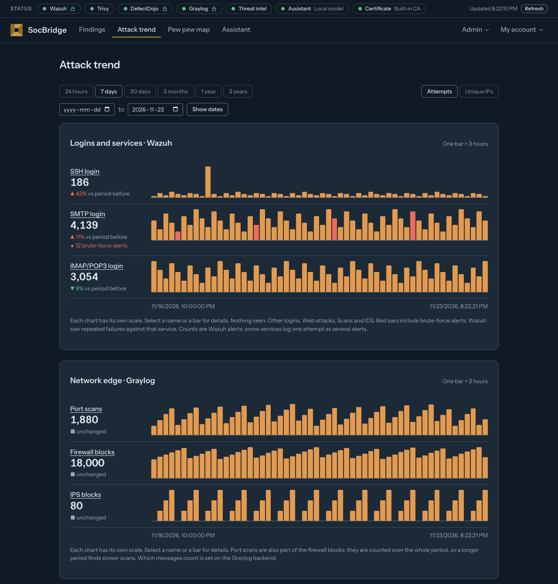

<details>
<summary>Who is behind one attack type</summary>

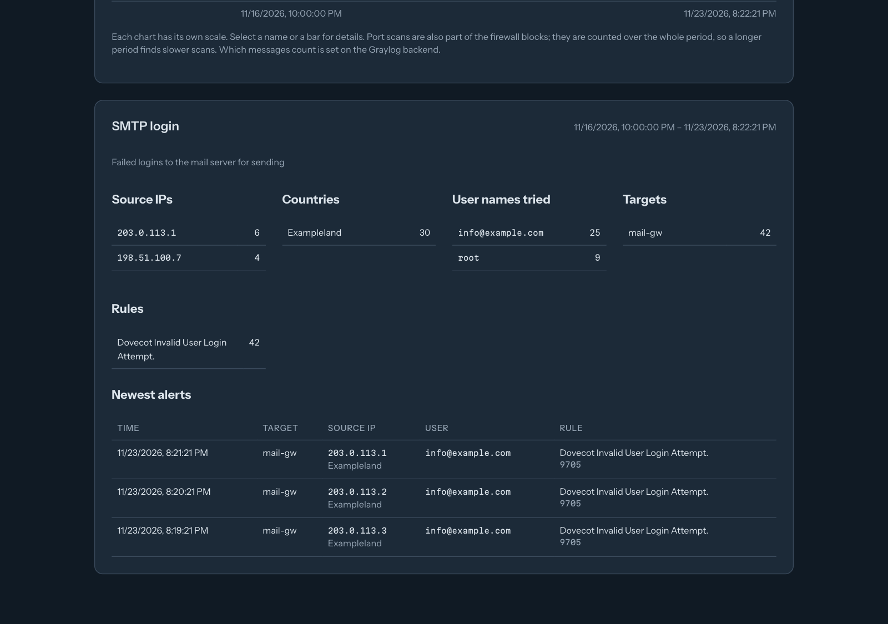

</details>

**Pew pew map.** Wazuh's attack alerts at the GeoIP position of each source,
live or replayed, on an amber CRT. Countries glow deeper the more attacks come
from them. Missiles follow great circles to where your machines are (set on the
Wazuh backend); squares mark the sources only. With Graylog and a GeoIP file,
port scans, IPS blocks and firewall blocks are layers of their own (firewall
blocks start off, as they are mostly noise).

The GeoIP file is a city database in MaxMind format, such as
[DB-IP City Lite](https://db-ip.com/db/download/ip-to-city-lite) or GeoLite2-City.
Unpack it as `geoip.mmdb` in the data directory, or point `GEOIP_DB` at it,
readable by uid 1000. It is read into memory (60–130 MB), addresses never leave
the server, and a replaced file is picked up within a minute. Blocks are summed
per source and time slot (an hour, six hours in the 7-day replay, a minute
live), for the 150 busiest sources per layer.

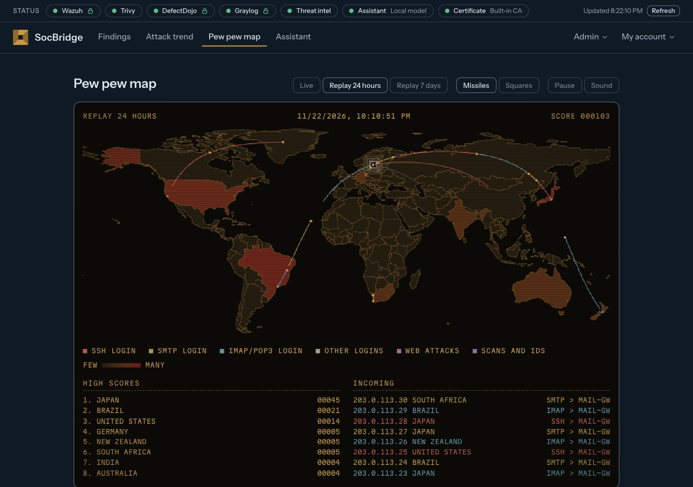

<details>
<summary>The same attacks as squares</summary>

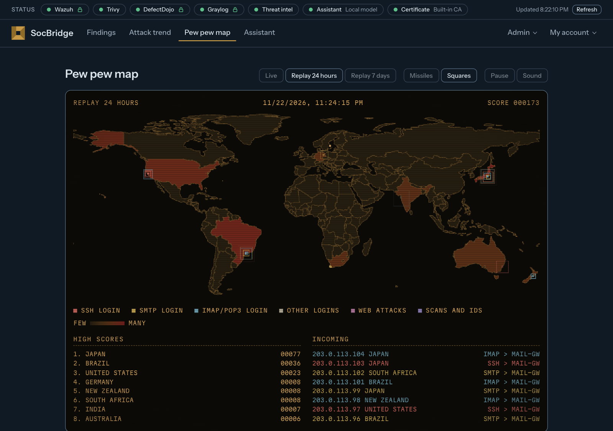

</details>

## How it works

```
 MCP client ──HTTPS + Bearer token──▶  /mcp  ─┬─▶ Wazuh manager API
 (token or OAuth, e.g. Claude connector)       │
                                              ├─▶ Wazuh indexer (OpenSearch)
 Browser ──HTTPS + passkey session──▶  /      ├─▶ DefectDojo API v2
                                       /api   ├─▶ Graylog API (+ /api/mcp)
 Deploy check ────────────────────────▶ /health ├─▶ Trivy JSON reports (read-only dir)
                                              └─▶ CISA KEV + FIRST EPSS feeds (intel)
```

- **Transport:** MCP Streamable HTTP in stateless mode. Each `POST /mcp`
  gets a fresh server instance; no session ID is issued. `GET`/`DELETE /mcp`
  return 405.
- **Access tokens:** per user, created in the web UI, shown once, stored only
  as SHA-256 hashes, each with a scope (none, read or write per backend).
  Every MCP request, and every tool call within it, is checked against the
  live configuration, so revoking a token, a grant or a backend's write switch
  takes effect on the next call. Optional expiry. Repeated failures from one
  address are rate-limited.
- **Tool allowlist:** per backend on the Backends page; until edited, a
  backend offers its read tools. Write tools are never on by default.
- **Audit log:** every tool call (user, token, tool, arguments with secrets
  redacted, outcome, duration; results only as size and hash), encrypted and
  hash-chained in `DATA_DIR/audit.log`, on the admin Audit page, optionally
  forwarded to Graylog over GELF HTTP. Sign-ins and changes to users, tokens
  and settings are recorded too (`auth.*`, `admin.*`). Those and completed
  writes are kept in their own chain, `audit-protected.log`, so a flood of
  reads or refused calls cannot rotate them out.
- **Passkey confirmation:** creating tokens, invites and passkeys, approving
  apps and changing users or settings need a passkey check from the last 15
  minutes; the console asks for it.
- **Read access per user:** administrators can limit a user to some backends
  on the Users page (default: all). It applies to the console, the assistant
  and the user's tokens and apps.
- **Rate limits:** each user may send 300 MCP messages and 120 console
  changes per minute, over all their tokens.
- **OAuth for connectors:** clients that cannot be given a token, such as a
  Claude custom connector, use OAuth 2.1 instead: discovery metadata, dynamic
  client registration, authorization code with PKCE. The user approves the
  connection in the web UI after signing in with their passkey.
- **Web UI login:** passkeys (WebAuthn) only, no passwords. On a machine without
  one, *Use a phone (QR code)* signs in with the passkey on a phone; the browser
  requires Bluetooth on both devices, as proof that the phone is nearby. Roles: `admin`
  (users, invites, backend settings) and `user` (own tokens and passkeys).
  The first admin enrols with a one-time setup token; later users enrol via
  single-use invite links that expire after 24 hours.
- **Config at rest:** users, passkeys, token hashes, invites and backend
  settings (URLs, credentials) are stored in one file encrypted with
  AES-256-GCM. The key comes from `CONFIG_ENCRYPTION_KEY` or
  `CONFIG_ENCRYPTION_KEY_FILE`.
- **Web UI:** self-contained, no CDN or external assets, served with a
  nonce-based Content-Security-Policy.
- **`/health`:** unauthenticated, returns `{"status":"ok"}` and
  nothing about backends.

## Read and write access

A write tool is offered, and works, only when **all four** say yes:

| Who decides | Where | Default |
|---|---|---|
| The installation | Admin → Backends → *Tools* → **Allow write tools** | Off |
| The installation | The same list: **tick each write tool** | Not ticked |
| The user | Admin → Users → **Write grants** per backend (administrators need a grant too) | None |
| The credential | Token scope, or the choice on the OAuth consent screen, set to **Read and write** for that backend | Read for tokens, no access for apps |

The credentials SocBridge uses need the rights as well: the *Writer* role in
DefectDojo, and `agent:modify_group` and `active-response:command` for the Wazuh
manager API user. Leave them read-only until you need the write tools.

| Write tool | What it changes |
|------------|-----------------|
| `defectdojo_close_finding` | Closes one finding as mitigated. |
| `defectdojo_risk_accept_finding` | Creates a risk acceptance for one finding, with an optional expiry date. |
| `defectdojo_mark_false_positive` | Marks one finding as a false positive and inactive. |
| `wazuh_add_agent_group`, `wazuh_remove_agent_group` | Adds one agent to, or removes it from, one agent group. |
| `wazuh_run_active_response` | Runs one command from the administrator's list on one connected agent. Marked destructive; does not exist while the list is empty. |

- Write tools take exact IDs, and their descriptions start with `[WRITE …]` so
  the client and its user see that they change something.
- The DefectDojo tools require a reason. It is added to the finding as a note
  naming the SocBridge user, and the state before and after is returned.
- Active response has no free-form arguments, only an optional source IP.
- Taking away any of the four applies from the next call, also for credentials
  already handed out. The scope of a token or a connected app can be changed
  in place with **Edit scope**.
- If the audit log cannot be written, write tools are refused.

## Install with an LLM agent

The [install guides for LLM agents](docs/install/README.md) are step-by-step,
with a check after every step: [SocBridge only](docs/install/socbridge.md), or
the [full stack](docs/install/full-stack.md) with Wazuh, Graylog, DefectDojo
and Trivy. Clone this repository on the host, start an agent in it and paste:

```text
Read docs/install/README.md and install SocBridge by following it.
Ask me which guide to use and for anything you need first.
```

## Quick start (Docker Compose)

The bundled `docker-compose.yml` is an example; adapt it.

```bash
mkdir -p secrets
openssl rand -hex 32 > secrets/config_key
sudo chown 1000 secrets/config_key && chmod 400 secrets/config_key
# edit PUBLIC_URL in docker-compose.yml
docker compose up -d --build
docker compose logs socbridge | grep "SETUP TOKEN" | tail -1
```

1. Open `PUBLIC_URL` in a browser. The first-time setup guide has three steps:
   1. **Setup token** from the log.
   2. **Certificate.** Passkeys (WebAuthn) do not work on a page with a
      certificate warning, so the browser must trust the site first. Either
      get a Let's Encrypt certificate via Cloudflare DNS-01 right there (the
      setup token authorises this one step), or download `/ca.crt` and trust
      the built-in CA. Before typing a Cloudflare token into a page whose
      certificate is not trusted yet, compare the CA fingerprint in the
      browser's certificate view with the `Built-in CA ready` line in the log.
      This step needs `TLS_MODE` unset; with `TLS_MODE` set the environment
      decides (use `TLS_MODE=acme` to have a trusted certificate from the
      first start).
   3. **Administrator passkey.** You are now admin; the setup token stops
      working everywhere, including the certificate step.
2. **Admin → Backends** → fill in Wazuh, tick *Enabled*, **Save**, **Test connection**.
3. **My account → Access tokens** → create a token and copy the `claude mcp add …` line.
4. **Admin → Users** → create invite links for other people.

> **Keep the encryption key safe.** Without it the config cannot be read;
> losing it means re-creating users and backend settings.

## Running without Docker

Requires Node.js 24 or newer (the runtime image is `node:24-alpine`).

```bash
npm ci
npm run build
cp .env.example .env   # then edit; or export the variables directly
set -a; . ./.env; set +a
DATA_DIR=./data node dist/index.js
```

`npm test` runs the unit tests after a build; `npm run test:e2e` starts the
server against a mock Wazuh and runs real passkey ceremonies with a software
authenticator.

## CI and deployment

`.github/workflows/build.yml` runs the unit and end-to-end tests on Node 24 and,
on `main`, pushes `ghcr.io/<owner>/<repo>:main` and `:main-<sha>`.
`.github/workflows/deploy.yml` then runs on a self-hosted runner labelled
`socbridge` on the target host: it pulls the exact `main-<sha>` image, recreates
only the `socbridge` compose service, waits for it to be healthy, checks that
the running container was built from the deployed commit and that `/mcp` refuses requests without
a token, and rolls back to the previous image if any step fails. All
host-specific values (compose file, env file, URL, Docker socket proxy) come
from the runner's environment; see the header of `deploy.yml`.

## Configuration

Only process-level settings live in environment variables. Everything else
(users, tokens, backend URLs and credentials) is managed in the web UI and
stored encrypted in `DATA_DIR/config.enc.json`.

| Variable | Required | Default | Description |
|----------|----------|---------|-------------|
| `PUBLIC_URL` | yes | – | External origin, e.g. `https://socbridge.example.com`. Must be `https://` with a hostname (not an IP) and no path. Used as the WebAuthn relying party and in links. |
| `CONFIG_ENCRYPTION_KEY` | one of | – | 32 bytes as 64 hex chars or base64. `openssl rand -hex 32`. |
| `CONFIG_ENCRYPTION_KEY_FILE` | one of | – | Path to a file containing the key (e.g. a Docker secret). |
| `CONFIG_ENCRYPTION_KEY_PREVIOUS` / `…_FILE` | no | – | Earlier keys, comma separated. To change the key, set the new one above and the old one here: config and certificates are re-encrypted at start. Keep the old key here while audit records written with it should stay readable. |
| `ENCRYPTION_FORMAT` | no | `1` | `2` encrypts each kind of data with its own derived key. Versions that do not know format 2 cannot read it, so set it only when you will not roll back past this version. |
| `REQUIRE_SECURE_TRANSPORT` | no | `false` | `true` refuses plain http and unverified TLS to backends and the GELF input, and write tools over them. Loopback is exempt. |
| `TLS_MODE` | no | `builtin` | `builtin`, `file`, `acme` or `off` – see below. |
| `TLS_CERT_FILE` / `TLS_KEY_FILE` | with `file` | – | PEM certificate (may include chain) and key. |
| `TLS_EXTRA_SANS` | no | – | Extra DNS names/IPs for the built-in certificate, comma separated. A Let's Encrypt certificate only takes the public DNS names among them (bare host names, IPs and `.local`/`.lan` names are left out). |
| `ACME_AGREE_TOS` | with `acme` | – | Must be `true`: accepts the CA's subscriber agreement. |
| `CLOUDFLARE_DNS_API_TOKEN` / `…_FILE` | with `acme` | – | Cloudflare API token (Zone:Read, DNS:Edit) for DNS-01. |
| `ACME_EMAIL` | no | – | Contact address for the ACME account. |
| `ACME_STAGING` | no | `false` | Use the Let's Encrypt staging CA. |
| `ACME_DNS_RESOLVERS` | no | `1.1.1.1,8.8.8.8` | Public resolvers used to confirm the challenge record. |
| `PORT` | no | `8443` (`8080` when TLS off) | Listen port. |
| `HOST` | no | `0.0.0.0` | Listen address. |
| `DATA_DIR` | no | `/data` | Encrypted config, TLS material, audit log and vulnerability snapshots. |
| `TRUST_PROXY` | no | off | Express `trust proxy` value (`loopback`, hop count, or subnets) when behind a reverse proxy. |
| `OAUTH_REDIRECT_HOSTS` | no | `claude.ai,claude.com` | Hosts OAuth clients may use as `https` redirect URIs (comma-separated, `*` for any). Loopback `http://localhost` redirects are always allowed. |
| `SETUP_TOKEN` | no | random | Fixed first-admin enrolment token (≥ 24 chars). Unused once an admin exists. |
| `LOG_LEVEL` | no | `info` | `debug`, `info`, `warn`, `error`. Logs are JSON lines. |

### TLS modes

**Certificates are managed in the web UI** (*Server* page, administrators)
unless `TLS_MODE` is set in the environment. Leave `TLS_MODE` unset and the
server starts on the built-in CA; an administrator can then switch to Let's
Encrypt by entering a Cloudflare API token, run a dry run against the staging
CA first, and switch back at any time. The change takes effect without a
restart; the built-in certificate keeps serving until the new one is issued.
The token is stored encrypted and never shown again. Setting `TLS_MODE` (any
value) locks the page and the environment decides, as described below.

- **`builtin`** – on first start a private CA (10 years) is created and used
  to issue a server certificate (90 days) for the `PUBLIC_URL` host plus
  `TLS_EXTRA_SANS`. The certificate is re-issued automatically when fewer than
  30 days remain or the names change, and swapped in without a restart.
  Entirely offline. Keys are stored encrypted with the config key; the public
  CA certificate is written to `DATA_DIR/tls/ca.crt` and served at `/ca.crt`
  so clients can trust it.
- **`acme`** – a publicly trusted Let's Encrypt certificate obtained with
  the **DNS-01** challenge through the Cloudflare API, so the service itself
  never has to be reachable from the internet: point the name at the internal
  address in local DNS, and only a temporary `_acme-challenge` TXT record
  appears in the public zone during validation. Requires `ACME_AGREE_TOS=true`
  and a Cloudflare API token (`CLOUDFLARE_DNS_API_TOKEN` or `…_FILE`) with
  *Zone:Read* and *DNS:Edit*, ideally limited to the one zone. The account
  key, certificate and key are stored encrypted. Renewal starts 30 days
  before expiry and the certificate is hot-swapped. If no certificate can be
  obtained at startup, a temporary certificate from the built-in CA is served
  and issuance is retried every 30 minutes. `ACME_STAGING=true` uses the
  staging CA for testing.
- **`file`** – bring your own certificate. Files are re-read when they change
  (checked every minute), so external renewal tooling works without restarts.
- **`off`** – plain HTTP for use behind a reverse proxy that terminates TLS.
  `PUBLIC_URL` must still be the external `https://` URL. Set `TRUST_PROXY`.
  Do not expose the plain-HTTP port directly.

## Connecting Claude Code

```bash
claude mcp add --transport http socbridge https://socbridge.example.com/mcp \
  --header "Authorization: Bearer msec_…"
```

With `TLS_MODE=builtin`, Claude Code (Node.js) must trust the private CA:

```bash
curl -fsSo ~/.config/socbridge-ca.crt --insecure https://socbridge.example.com/ca.crt
# verify the fingerprint against the server log ("Built-in CA ready"), then:
export NODE_EXTRA_CA_CERTS=~/.config/socbridge-ca.crt
```

## Connecting with a config file (Claude Desktop and others)

Use this when a client cannot add a server by URL, or you would rather use a
token than OAuth. The **Access tokens** page shows these snippets with your
server URL and, right after you create one, your token filled in.

### Claude Desktop

`claude_desktop_config.json` only starts local (stdio) servers, so
[`mcp-remote`](https://www.npmjs.com/package/mcp-remote) (needs Node.js)
bridges to `/mcp` and sends the token. Open **Settings → Developer → Edit
Config** (`~/Library/Application Support/Claude/claude_desktop_config.json` on
macOS, `%APPDATA%\Claude\claude_desktop_config.json` on Windows), merge this
in and restart Claude Desktop completely:

```json
{
  "mcpServers": {
    "socbridge": {
      "command": "npx",
      "args": [
        "-y", "mcp-remote", "https://socbridge.example.com/mcp",
        "--transport", "http-only",
        "--header", "Authorization:${SOCBRIDGE_AUTH}"
      ],
      "env": {
        "SOCBRIDGE_AUTH": "Bearer msec_…"
      }
    }
  }
}
```

- No space after `Authorization:`. The space sits in the env value, because
  Claude Desktop passes spaces in `args` badly (notably on Windows).
- `--transport http-only`: `/mcp` is stateless Streamable HTTP without SSE.
- With `TLS_MODE=builtin`, add `"NODE_EXTRA_CA_CERTS": "/path/to/socbridge-ca.crt"`
  to `env` (see above for fetching and checking the CA).
- Logs: `~/Library/Logs/Claude/mcp-server-socbridge.log`. A 401 means a wrong
  or revoked token, or a missing `Bearer`.

### Clients that speak HTTP

Claude Code (`.mcp.json`), Cursor, VS Code and similar take the URL and a
header directly. The format is the same or nearly so:

```json
{
  "mcpServers": {
    "socbridge": {
      "type": "http",
      "url": "https://socbridge.example.com/mcp",
      "headers": { "Authorization": "Bearer msec_…" }
    }
  }
}
```

To test a token without a client:

```bash
curl -s https://socbridge.example.com/mcp -H "Authorization: Bearer msec_…" \
  -H "Content-Type: application/json" -H "Accept: application/json, text/event-stream" \
  -d '{"jsonrpc":"2.0","id":1,"method":"tools/list"}'
```

## Connecting a Claude custom connector

Claude (claude.ai, Claude Desktop, mobile) adds remote MCP servers as
**custom connectors**, which sign in with OAuth rather than a token. An
administrator first enables **Admin → Server → Connectors (OAuth)**; it is off
by default. Then:

1. In Claude open **Settings → Connectors → Add custom connector**.
2. Name it (e.g. `SocBridge`) and enter `https://socbridge.example.com/mcp` as the
   MCP server URL. Leave the advanced OAuth fields empty; Claude registers
   itself.
3. Click **Continue / Connect**. Your browser opens the SocBridge console: sign
   in with your passkey, choose the access per backend and click **Approve**.
   You are sent back to Claude.

The connection acts as you and appears under **Access tokens → Connected
apps**, where you (or an admin) can disconnect it; that revokes it at once.
Access tokens last an hour and are refreshed automatically; a connection
unused for 30 days has to be approved again.

Requirements: Claude calls the server from Anthropic's cloud, so `PUBLIC_URL`
must be reachable from the internet and serve a publicly trusted certificate
(`TLS_MODE=acme`, or a proxy with a public certificate). The built-in CA does
not work for connectors.

## Connecting ChatGPT

ChatGPT adds remote MCP servers as apps in Developer mode and always signs
in with OAuth. Connectors must be enabled as above. ChatGPT is also opt-in: add its host to the redirect allow-list
first, e.g. `OAUTH_REDIRECT_HOSTS=claude.ai,claude.com,chatgpt.com`, and
restart.

1. In ChatGPT on the web open **Settings → Apps & Connectors → Advanced
   settings** and turn on **Developer mode** (paid plans).
2. Back in **Apps & Connectors**, click **Create**. Enter a name and
   `https://socbridge.example.com/mcp`, and choose **OAuth** as authentication.
3. Confirm you trust the app and click **Create**. Approve the request in the
   SocBridge console with your passkey.

The same requirements as for Claude connectors apply: a public URL and a
publicly trusted certificate. The Access tokens page shows these steps too.

## Examples

### Questions to ask

Once a client is connected, ask in plain language; the model picks the tools.
Some questions and the tools they typically lead to:

| Question | Tools |
|---|---|
| Which hosts have critical vulnerabilities? | `wazuh_vulnerability_overview` |
| What should we fix first, and why? | `intel_fix_first` (KEV, EPSS, exposure, attacks and service importance, with evidence) |
| Which internet-facing hosts have exploited vulnerabilities and were attacked in the last 24 hours? | `intel_investigate` |
| Are we affected by CVE-2024-3094? Where? | `intel_cve_lookup`, `trivy_find_cve`, `wazuh_vulnerability_overview` |
| Is build-runner getting better or worse? | `wazuh_vulnerability_trend`, `wazuh_agent_vulnerabilities` |
| Which DefectDojo findings are past their SLA? | `defectdojo_sla_overview`, `defectdojo_list_findings` |
| Any failed SSH logins in the last 24 hours? | `wazuh_search_alerts`, `graylog_search` |
| Which newly exploited CVEs affect us? | `intel_kev_recent` |
| Is everything up, or is that empty result an outage? | `socbridge_backends` |

### A tool call over plain HTTP

What a client sends and gets back: the critical vulnerabilities across all
Wazuh agents. The response is the tool's JSON, as text content (sample data):

```bash
curl -s https://socbridge.example.com/mcp \
  -H "Authorization: Bearer msec_…" \
  -H "Content-Type: application/json" -H "Accept: application/json, text/event-stream" \
  -d '{"jsonrpc":"2.0","id":2,"method":"tools/call",
       "params":{"name":"wazuh_vulnerability_overview",
                 "arguments":{"severity":["Critical"],"top":5}}}'
```

```json
{
  "total": 7,
  "by_severity": { "Critical": 7 },
  "top_agents": [
    { "agent_id": "003", "agent_name": "build-runner", "total": 3, "by_severity": { "Critical": 3 } },
    { "agent_id": "002", "agent_name": "db-primary", "total": 2, "by_severity": { "Critical": 2 } },
    { "agent_id": "001", "agent_name": "web-01", "total": 1, "by_severity": { "Critical": 1 } },
    { "agent_id": "004", "agent_name": "mail-gw", "total": 1, "by_severity": { "Critical": 1 } }
  ],
  "top_cves": { "CVE-2024-3094": 3, "CVE-2023-45853": 2, "CVE-2024-45490": 2 }
}
```

### A write

| Request | Tool |
|---|---|
| Close DefectDojo finding 12, fixed by upgrading openssh-server | `defectdojo_close_finding` |
| Accept the risk of finding 11 until the end of the quarter | `defectdojo_risk_accept_finding` |
| Move build-runner to the quarantine group | `wazuh_list_agents`, `wazuh_list_groups`, `wazuh_add_agent_group` |
| Block 203.0.113.9 on web-01 | `wazuh_run_active_response` |

### A write the token may not make

A token scoped *read* for DefectDojo does not get the write tools at all, so
a client cannot call them even by name:

```bash
curl -s https://socbridge.example.com/mcp -H "Authorization: Bearer msec_…" \
  -H "Content-Type: application/json" -H "Accept: application/json, text/event-stream" \
  -d '{"jsonrpc":"2.0","id":3,"method":"tools/call",
       "params":{"name":"defectdojo_close_finding",
                 "arguments":{"finding_id":12,"note":"Mitigated: upgraded openssh-server to 9.8p1"}}}'
```

```json
{"result":{"content":[{"type":"text","text":"MCP error -32602: Tool defectdojo_close_finding not found"}],"isError":true},"jsonrpc":"2.0","id":3}
```

The attempt still lands in the audit log as *denied*, with the user, the
token and the arguments (see the audit screenshot above).

## Backends

### Wazuh

Wazuh 4.8+ keeps vulnerability detection results in the indexer
(`wazuh-states-vulnerabilities-*`), so the vulnerability and alert tools need
indexer access. Without indexer settings only the agent tools are offered.

Settings:

- **Manager API URL**, user, password – an API user with read access to
  agents (default port 55000). The write tools need more rights, see below.
- **Indexer URL**, user, password – a user with read access to
  `wazuh-alerts-*` and `wazuh-states-vulnerabilities-*` (default port 9200),
  plus the cluster permissions `cluster_composite_ops_ro` and
  `cluster:monitor/main`. The built-in `readall` role alone is not enough.
- Index patterns (defaults match a standard install).
- **Verify TLS** and an optional **CA certificate** (PEM). Wazuh ships with
  self-signed certificates; pasting its root CA here is preferable to turning
  verification off.
- **Allowed active-response commands** – what `wazuh_run_active_response` may
  send, e.g. `!firewall-drop`. Empty: the tool does not exist.
- **Attack map: where your machines are** – coordinates the shots on the *Pew pew map* page are aimed at.
  The map plays real alerts at the position Wazuh's GeoIP lookup gave each source address; its coastlines and
  borders (`public/design/world.json`) are from Natural Earth 1:110m, public domain.

Tools:

| Tool | Purpose |
|------|---------|
| `wazuh_list_agents` | Agents with status, OS, version, groups; filter by status, group, platform, text. |
| `wazuh_get_agent` | Full details for one agent. |
| `wazuh_agent_vulnerabilities` | Vulnerabilities on one agent, highest CVSS first, with severity counts. Filter by severity, package, CVE. |
| `wazuh_vulnerability_overview` | Fleet-wide counts by severity, top affected agents and most common CVEs. |
| `wazuh_vulnerability_trend` | New and resolved findings per day and per agent over the last N days (from hourly snapshots of the open findings; before the first snapshot from vulnerability detector alerts, Wazuh 4.8+, which miss feed updates), plus how many are open now. A CVE that is closed and reopened by a package upgrade counts as re-detected, not as new and resolved. |
| `wazuh_attack_trend` | Attacks over time (a preset from 24h to 3y, or any range up to five years) per category: failed SSH, SMTP, IMAP/POP3 and FTP logins, web attacks, scans, and any other service found in the alerts (by Wazuh rule group), with attempts, distinct source IPs, how many Wazuh flagged as brute force and the preceding period. Also on the *Attack trend* page. |
| `wazuh_attack_details` | One attack category in a time range: top source IPs, countries, user names tried, targets and rules, and the newest alerts. |
| `wazuh_search_alerts` | Alerts in a time window, filtered by level, agent, rule, group and an optional Lucene query. |
| `wazuh_get_alert` | The complete alert document for one alert ID. |
| `wazuh_fim_events` | File integrity (syscheck) changes in a time window; filter by agent, path or path prefix, and added/modified/deleted. |
| `wazuh_list_groups` | Agent groups with their agent counts. |
| `wazuh_agent_sca` | Configuration assessment (SCA) policies on one agent with score and pass/fail counts. |
| `wazuh_sca_checks` | Checks of one SCA policy on one agent, with remediation and compliance; filter by result. |
| `wazuh_agent_inventory` | Syscollector inventory of one agent: OS, hardware, packages, processes, ports, network, hotfixes. |
| `wazuh_get_rule` | Rule definitions by ID: level, groups and compliance mappings. |
| `wazuh_list_decoders` | Decoder definitions by name or search: file, position, prematch/regex and parent. |
| `wazuh_fim_files` | What FIM currently tracks on one agent (path, size, owner, permissions, hashes) and when the last scan ran; look up a path or a hash. |
| `wazuh_add_agent_group` | **Write.** Adds one agent to one existing group, so the group's configuration is pushed to it. |
| `wazuh_remove_agent_group` | **Write.** Removes one agent from one group. |
| `wazuh_run_active_response` | **Write, destructive.** Runs one allowed active-response command on one connected agent, with an optional source IP. |

The alert, attack, FIM event and vulnerability tools need the indexer; the
others use only the manager API.

### Trivy

Trivy has no query API (`trivy server` only serves its database to Trivy
clients), so SocBridge reads JSON reports written by a scheduled scan job
(`trivy image --format json -o …`) into a directory mounted read-only into
this container. `.json` files in that directory and its subdirectories are
read (up to 6 levels deep and 5000 files; dot files and folders are skipped,
and symlinks that lead outside the directory are ignored), so a layout like
one folder per scan day works. Files that are not Trivy reports (or are over
64 MB) are skipped and listed as unreadable. Parsed reports are cached and
re-read when a file changes. The connection test reads every report and says
how many parsed.

Reports with the same artifact name and type are scans of one artifact over
time, ordered by `CreatedAt`; keep older reports to get history.

Tools:

| Tool | Purpose |
|------|---------|
| `trivy_list_reports` | Reports (one per image or filesystem scan), newest scan first, with OS and vulnerability counts by severity; filter by artifact name, or show only the latest report per artifact. |
| `trivy_report_findings` | Vulnerabilities in one report (by file or artifact name), most severe first; filter by severity, package, fixable only. Misconfigurations and secrets on request — secrets by rule, file and line only, never the matched text. |
| `trivy_find_cve` | Which images/filesystems contain one CVE, via which package and version, and whether a fix exists. |
| `trivy_artifact_history` | All scans of one image or filesystem with counts by severity, and which CVEs were fixed and which are new between the latest two scans (or two chosen ones). |

### DefectDojo

REST API v2 with `Authorization: Token …`; use the key of a user with the
Reader role, or the Writer role if you use the write tools. The connection test calls `GET /api/v2/products/`.

Tools:

| Tool | Purpose |
|------|---------|
| `defectdojo_list_findings` | Findings, most severe and newest first, with product/engagement/test names. Active, non-duplicate, non-false-positive by default; filter by product, engagement, severity, verified, vulnerability ID, title and discovery date. |
| `defectdojo_get_finding` | Full details for one finding (description, mitigation, impact, references, endpoints, CVSS/EPSS). Long text is capped. |
| `defectdojo_list_engagements` | Engagements, newest first; filter by product, status, name. |
| `defectdojo_list_products` | Products with IDs, criticality, lifecycle and finding counts. |
| `defectdojo_list_tests` | Tests (one per scan), newest first, in an engagement or product; filter by test type or scan type. Open finding counts per test on request (one extra request per test). |
| `defectdojo_list_endpoints` | Endpoints (protocol, host, port, path) with active finding counts, most findings first; filter by product and exact host. |
| `defectdojo_list_imports` | Recent scan imports/reimports: when, test and scan type, and how many findings were created, closed, reactivated or untouched; filter by test. |
| `defectdojo_sla_overview` | Open findings per severity and how many are past their SLA date, for all products or one, plus the most overdue findings. |
| `defectdojo_close_finding` | **Write.** Closes one finding as mitigated; needs a note saying what fixed it. |
| `defectdojo_risk_accept_finding` | **Write.** Accepts the risk of one finding with a reason and an optional expiry date, after which DefectDojo reactivates it. |
| `defectdojo_mark_false_positive` | **Write.** Marks one finding as a false positive (inactive, unverified); needs a reason. |

### Graylog

Access token as basic-auth user with password `token`, plus the
`X-Requested-By` header. Use a user with the Reader role and share only the
streams it should search. Tested against the Graylog 6/7 REST API.

| Tool | Purpose |
|------|---------|
| `graylog_search` | Messages matching a Graylog/Lucene query, newest first, via `POST /api/search/messages`. Defaults to the last 15 minutes and fields `timestamp, source, message`; relative (`range_seconds`) or absolute (`from`/`to`) ranges up to 30 days; streams by ID or title. Long fields are capped. |
| `graylog_list_streams` | Streams the token can read, with IDs and titles. |
| `graylog_system_health` | Node version and processing state, indexer cluster health, journal backlog, system notifications. Parts the token may not read show as unavailable. |
| `graylog_list_event_definitions` | Alert/event definitions: title, priority, alert flag, enabled state, a summary of query and condition (e.g. `count() > 10`, within 5m, every 1m) and notification names. Paged. |
| `graylog_search_events` | Triggered events and alerts via `POST /api/events/search`, newest first. Defaults to the last 24 hours; same time range rules as `graylog_search`; filter by event definition (ID or title), priority, alerts only, and an optional query. Paged. |
| `graylog_firewall_trend` | Port scans, firewall blocks and IPS blocks over time, same ranges as `wazuh_attack_trend`, via `POST /api/search/aggregate` (a read). Which messages count is set by the *Firewall blocks query* and *IPS query* settings; they need the fields `src_ip`, `dst_ip` and `dst_port`. Also on the *Attack trend* page. |
| `graylog_firewall_details` | One of those categories in a time range: top source IPs, ports, targets and IPS signatures, and the newest messages. |
| `graylog_list_dashboards` | Dashboards (`/api/dashboards`): ID, title, summary, owner, last update. Paged, filter by title. |
| `graylog_list_saved_searches` | Saved searches (`/api/search/saved`), same fields as dashboards. |
| `graylog_get_dashboard` | One dashboard or saved search by ID: pages with their queries and time ranges, and each widget's type, title, query, visualization, group-by and series. Layout only; widgets are not run. |

**Graylog MCP passthrough (optional).** Graylog 7 ships its own MCP server
(System → Configurations → MCP → Remote MCP access, served at `/api/mcp`).
Tick **Forward Graylog MCP tools** and SocBridge acts as an MCP client to it
with the same token, exposing selected tools as `graylog_mcp_<name>`. Clients
still talk only to SocBridge, so its tokens, rate limit, call log and result cap
apply. Which tools are forwarded:

- **Allowlist set** (comma or newline separated Graylog tool names): exactly
  those. Tools Graylog does not mark read-only count as write tools, and the
  Backends page has no write switch for Graylog, so they are not offered; list
  only tools that read.
- **Allowlist empty:** only tools Graylog annotates `readOnlyHint: true`.

**Test connection** lists every tool Graylog offers and which are exposed.
The tool list is cached for five minutes; if Graylog's MCP endpoint is down,
the forwarded tools disappear and the REST tools keep working.

### Threat intel (KEV and EPSS)

Ranks the CVEs the other backends report by how likely they are to be
exploited, so "what do I fix first" has an answer among thousands of open
findings. Two public feeds are downloaded **as whole files** and kept in
memory, so which CVEs you have is never sent anywhere:

- **CISA KEV**, the Known Exploited Vulnerabilities catalog (JSON, ~1 800
  CVEs): exploited in the wild, with CISA's required action, due date and
  whether it is known to be used by ransomware.
- **FIRST EPSS** (gzipped CSV, every published CVE): the probability of
  exploitation in the next 30 days and its percentile.

The feeds are fetched on first use and again after *Refresh interval* (24 h
by default); a failed refresh keeps the previous data and retries after five
minutes. Health reports each feed's date and freshness. Without internet
access, mirror the two files internally and set the URLs.

The CVEs come from the other backends, read **with the caller's own access**:
a token that may not read Wazuh gets a ranking without Wazuh's hosts, and the
result lists each source as `ok`, `unavailable` (with the reason) or `error`.
Wazuh contributes every open CVE per host (indexer), Trivy the newest report
per image, DefectDojo the active findings per product. When Trivy is also
used, DefectDojo findings imported from Trivy scans are left out so images are
not counted twice. Name the DefectDojo products that hold internet-facing scan
results under *Internet-facing DefectDojo products*: CVEs there count as
exposed. Collected inventories are reused for ten minutes (`refresh: true`
re-reads).

Priority, first rule that matches:

| Priority | Rule |
|----------|------|
| P1 | In CISA KEV |
| P2 | EPSS ≥ 0.1, or Critical/High on an internet-facing asset |
| P3 | Critical/High, or EPSS ≥ 0.01 |
| P4 | The rest |

Within a priority: known ransomware use, exposure, EPSS, CVSS, number of
affected assets. Every CVE carries the reasons for its rank.

| Tool | Purpose |
|------|---------|
| `intel_investigate` | Services that meet several conditions at once (exposure, exploited vulnerabilities, attacks), those that might, vulnerable assets in no service, and the gaps. |
| `intel_fix_first` | Ranked remediation actions (A1–A4) with reasons, recommendation, confidence and the records behind them. |
| `intel_prioritize_cves` | All open CVEs across the sources, merged per CVE and ranked P1–P4 with reasons, KEV entry, EPSS, and affected hosts/images/products (package, installed and fixed version). Filter by priority, KEV only, minimum EPSS or severity, exposed or fixable only, asset or CVE. |
| `intel_kev_recent` | CVEs added to KEV in the last N days, each marked with where it occurs in your environment. |
| `intel_cve_lookup` | KEV entry and EPSS score for up to 200 CVE IDs, from the downloaded feeds. |

Existing access tokens and connected apps do not include *Threat intel*;
add it with *Edit scope*. Needs outbound HTTPS to `www.cisa.gov` and
`epss.empiricalsecurity.com`.

#### Service map

The backends share no key: Wazuh knows hosts, Trivy images, DefectDojo
endpoints. *Admin → Services* links them per service, with importance and
exposure, and suggests what is not mapped yet. `intel_investigate`,
`intel_fix_first` and the *Fix first* page use only the links made there;
whatever is not mapped or could not be read is listed as a gap, never taken
as "not exposed" or "not attacked".

- *Reached* means Wazuh alerts on the host from public addresses. Firewall
  and IPS blocks are weaker and never count as reached. Neither means that a
  vulnerability was exploited, unless an alert names the CVE.
- IPS logs without a target address (UniFi's) are counted but not tied to a service.
- Alerts without a public source address, for example behind a proxy or
  container NAT, do not count as attacks and are reported as a gap.
- If you edited the Threat intel tool allowlist, add the two tools to it.

## Assistant (built-in chat)

The **Assistant** page lets any signed-in user ask questions in plain
language ("which hosts have critical vulnerabilities?"). The model looks
things up with exactly the same read-only tools that `/mcp` offers: the chat
connects to the MCP server in-process, so it can never do more than an MCP
client can, and it gets no write tools whatever the user's grants.

An admin picks the provider under **Admin → Server → Assistant**:

| Provider | Needs | Notes |
|---|---|---|
| Claude (Anthropic API) | API key | Default model `claude-opus-5-5`. Refusal fallbacks are switched on for models that support them. |
| OpenAI | API key, model name | Chat completions API; base URL defaults to `https://api.openai.com/v1`. |
| Local model | Base URL, model name | Any OpenAI-compatible server: Ollama (`http://ollama:11434/v1`), LM Studio, vLLM, llama.cpp. The model must support tool calling. Key optional. |

API keys are stored encrypted in the config, one per provider, and are
write-only. **Test connection** checks the key and model without generating
any tokens.

What leaves the server: the question, earlier turns of the same conversation,
and the tool results the model asks for (host names, package versions, CVE
IDs, alert text) go to the chosen provider. With a local model nothing leaves
your network. Conversations are kept only in the browser tab's memory; the
server logs who asked, which tools ran and how long it took, never the text.

## Adding a backend

Each backend is a module under `src/backends/<id>/` implementing
`BackendModule` from `src/backends/types.ts`:

- `fields` – drives the settings form (`secret` fields are write-only in the API).
- `schema` – zod schema validating stored settings.
- `createRuntime(cfg)` – builds the API client. Runtimes are cached and only
  rebuilt when settings change, so auth tokens survive stateless requests.
- `testConnection(rt)` – used by the **Test connection** button.
- `tools` – the module's MCP tools as descriptors, declared with
  `toolsFor<Rt>().read({...})` or `.write({...})`. The core registers them per
  request (enabled ∩ allowlist ∩ scope), derives the MCP annotations from
  read/write, audits and gates every call, and turns thrown errors into tool
  errors. Return results with `jsonResult()` from `src/backends/result.ts` so
  output is size-capped. A write tool must take exact IDs and say in its first
  sentence what it changes.

Register the module in `src/backends/registry.ts`, and set `maturity: 'ready'`
once tools exist.

A tool that needs another backend's data (like the intel module) asks for it
with `ctx.source('<id>')`. It gets that backend's runtime and gate only when
the calling credential may read that backend at that moment, and otherwise a
reason it can show.

## Security notes

- Tokens: `msec_` + 256 random bits. Only the hash is stored.
- OAuth: PKCE (`S256`) is mandatory, codes are single-use and live 60 s,
  access tokens (`msat_`) 1 h, refresh tokens (`msrt_`) rotate on every use
  and expire after 30 days unused. Only hashes are stored. Dynamic client
  registration only accepts redirect URIs on `OAUTH_REDIRECT_HOSTS` or
  loopback, is rate-limited per address, and unused registrations are dropped
  after a day. A registration grants nothing by itself: every connection needs
  a signed-in user to approve it.
- Sessions: in memory, `__Host-` cookie, `HttpOnly`, `Secure`,
  `SameSite=Strict`, 2 h idle / 12 h absolute. A restart signs everyone out.
- State-changing API calls also require a custom header and a matching
  `Origin`.
- Passkeys require user verification. Signature counters are checked.
- Backend secrets are never returned by the API or logged.
- The first-admin setup token is printed to the log when generated (a
  "SETUP TOKEN" banner, repeated every 15 minutes until an admin exists); it is
  only valid until the first admin exists. Besides enrolling that admin it
  opens exactly one other thing, the certificate settings (`/api/server/tls`,
  header `x-setup-token`), so a trusted certificate can be set up before the
  first passkey. Wrong tokens count towards the same rate limit as sign-in.
- Assistant: tool results can contain attacker-controlled text (log lines,
  alert descriptions). The system prompt tells the model to treat them as
  data, the assistant only has read tools, and replies are rendered as text only: no
  HTML, links or images, so a prompt injection cannot make the browser fetch
  anything. One request per user at a time, at most 12 model steps each.

## Project layout

```
src/
  index.ts            startup, TLS listener
  env.ts              environment parsing and validation
  crypto/secretbox.ts AES-256-GCM envelope
  config/             schema + encrypted store
  auth/               tokens, sessions, rate limiting
  tls/                built-in CA and certificate handling
  http/               express app, /mcp, passkey and admin API
  mcp/server.ts       per-request MCP server assembly
  ai/                 assistant: providers (Claude, OpenAI, local) and the in-process tool bridge
  backends/           backend interface, registry and modules
public/               web UI (inlined into the page at request time)
```

## License

[MIT](LICENSE). Fonts in `public/design/fonts` are under the SIL Open Font License.
